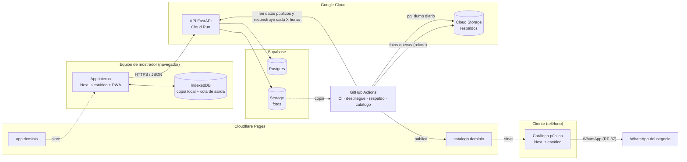

# Arquitectura — SHT Gestión

| Campo | Valor |
|---|---|
| Versión | 1.4 |
| Fecha | 2026-10-15 |
| Estado | Vigente (aprobada al cerrar la etapa 1.0) |
| Documentos relacionados | `docs/PRD.md`, `docs/decisiones/`, `.specify/memory/constitution.md` |

> Este documento describe **cómo** se construye el sistema. El **qué** y el **por qué**
> están en `docs/PRD.md`. Las decisiones y sus alternativas están en los ADR de
> `docs/decisiones/`; aquí se resumen y se enlazan.

## 1. Vista general



| Componente | Tecnología | Responsabilidad | ADR |
|---|---|---|---|
| API | FastAPI (Python) en Cloud Run | Toda la lógica de negocio, permisos, auditoría; única puerta a los datos | 0001, 0002, 0005 |
| Base de datos | Postgres en Supabase | Persistencia; sin Data API expuesta | 0001 |
| Fotos | Supabase Storage | Fotos de productos en WebP, bucket público; solo la API escribe | 0001, 0002, 0009 |
| App interna | Next.js estático + PWA en Cloudflare Pages | Ventas (con y sin conexión), caja, administración, inventario, compras, reportes | 0001, 0003 |
| Catálogo | Next.js estático en Cloudflare Pages | Catálogo público y pedido por WhatsApp; regenerado cada X horas | 0001, 0002 |
| Automatización | GitHub Actions | CI, despliegues, respaldo diario, regeneración del catálogo | 0002 |

## 2. Repositorio

```
backend/
  app/
    api/          endpoints (routers), dependencias de autenticación y roles
    domain/       reglas de negocio puras: dinero, unidades, costo promedio,
                  cálculo de la venta (sale_math), series y documentos de clientes
    services/     casos de uso transaccionales: venta, anulación, apertura de caja,
                  equipos, cola de salida (sync), descuentos, clientes, compras…
    db/           modelos SQLAlchemy, sesión, repositorios
    core/         configuración, seguridad, logging
  migrations/     Alembic
  tests/
frontend/         app interna (Next.js, PWA)
  src/
    app/          rutas (vender, ventas, caja, productos, inventario, compras, admin)
    lib/device/   identidad del equipo, token y correlativo en IndexedDB (Dexie)
    lib/outbox/   cola de salida: envío en orden, reintentos e idempotencia
    lib/api/      cliente HTTP con tipos generados del OpenAPI
catalog/          catálogo público (Next.js estático)
packages/shared/  TypeScript compartido: dinero (money.ts), UUIDv7, formato es-VE,
                  tipos generados; tema visual de Tailwind en styles/theme.css
                  (ADR-0007)
  test-vectors/   casos JSON que ejecutan las pruebas de Python y de TypeScript
docs/
  marca/          logo original (PDF) y SVG extraídos
.github/workflows/
docker-compose.yml  entorno local (Postgres)
```

La regla de dependencias del backend es `api → services → domain` y
`services → db`. `domain` no importa nada de la base de datos ni de FastAPI, para que
las reglas críticas se prueben sin infraestructura (principio VII).

## 3. Flujos principales

### 3.1 Venta en el mostrador (con o sin conexión)

Desde la etapa 1.3 la venta funciona con conexión pero ya sigue este camino completo; la
1.5 agrega la copia local de productos y el service worker sin cambiar la venta.

0. **Equipo y caja** (research R3, R7 de la 1.3): el Admin registra el navegador del
   mostrador (`POST /devices`) y recibe una serie (`A`, `B`…) y un token, que se guardan
   en IndexedDB. El Vendedor abre la caja con su fondo por la cola (`cash_session.open`).
1. El vendedor busca productos (en la 1.3, `GET /products`; en la 1.5, la copia local).
2. La app calcula totales en USD y Bs con la tasa vigente al empezar la venta, mostrando
   su fecha si no es la del día (RF-18), con `packages/shared/src/money.ts` (ADR-0004).
   Si la tasa cambia mientras se arma y aún no hay pagos, pide actualizarla.
3. Los descuentos del Vendedor se autorizan antes de confirmar: PIN del Admin validado en
   el servidor o solicitud que el Admin aprueba (`discount_authorizations`). La
   autorización queda atada a la venta, la línea, el valor y la base.
4. Al confirmar, la venta recibe su número `{serie}-{correlativo}` del contador local y un
   UUIDv7, y se guarda en la cola de salida (`lib/outbox`, ADR-0003).
5. La cola la envía de inmediato (`POST /sync/operations` con `X-Device-Token`); si no hay
   conexión, reintenta al volver, al abrir la app y cada 30 s con espera creciente.
6. La API (`services/sync.py`) bloquea el id de la operación; si ya se procesó, devuelve
   la respuesta guardada. Si no, `services/sales.py` valida lo estructural, recalcula con
   `domain/sale_math.py` y aplica en una sola transacción la venta, los pagos y vueltos,
   las salidas de kardex, el cliente, las alertas, la auditoría y la fila de la cola.
7. Si el stock queda negativo, o el precio, el total o la tasa no coinciden, o un
   descuento no tiene autorización válida, la venta se registra igual y se crea una
   alerta para el Admin (RN-10, RN-07). Solo se rechaza lo estructural (contenido
   inválido, caja de otro equipo, correlativo ocupado…); el rechazo también se guarda y
   se repite en un reenvío.
8. La respuesta se guarda localmente; la barra de la app muestra las operaciones
   pendientes o rechazadas.

Anular una venta (Admin, con conexión, `POST /sales/{id}/void`) genera el reverso de
kardex por línea y el espejo de cada pago y vuelto en la caja de la venta.

### 3.2 Operaciones con conexión (administración, compras, inventario)

La app llama a la API directamente. Cada caso de uso es una transacción: por ejemplo,
confirmar una compra crea los movimientos de entrada, recalcula el costo promedio con
bloqueo de fila del producto (RN-09) y audita, todo o nada.

- **Compras (RF-14 a RF-16, RN-14, RN-20; etapa 1.2):** el borrador se guarda entero
  (`PUT /purchases/{id}`) y el servidor recalcula todo con `domain/costing.py`: tasa
  aplicable, totales, gastos por porcentaje o monto fijo, reparto por valor y costo
  final por unidad. `services/purchases.py::confirm_purchase` bloquea la compra (una
  segunda confirmación falla), revalida proveedor, productos y tasa, bloquea los
  productos en orden de id (sin bloqueos cruzados), llama a `post_movement` con el costo
  antes y después, actualiza el costo promedio con el costo final y bloquea el costo
  inicial; al final toma el número de `sequence_counter`, así un fallo no deja huecos.
  Confirmar con un `updated_at` viejo responde `stale_data`. Anular genera los
  reversos, deshace el costo con el costo final y, si el resultado no es válido,
  conserva el costo y crea una alerta para el Admin. Los triggers de la migración
  `0005` impiden cambiar una compra confirmada, sus líneas o sus gastos.
- **Tasa BCV (RF-17, RN-15; adelantada a la 1.2):** `services/exchange_rates.py` carga
  y corrige la tasa con auditoría y resuelve la tasa aplicable a una fecha (la de ese
  día o la última anterior). Las compras copian el valor y la fecha de la tasa; la etapa
  1.3 la usará en las ventas desde el mismo servicio.

- **Kardex (RN-08, etapa 1.1b):** todo cambio de stock pasa por
  `services/inventory.py::post_movement`, que bloquea el producto e inserta el
  movimiento; un trigger verifica el saldo y actualiza `product.stock`, y otro rechaza
  cualquier escritura directa del stock. Las salidas del Almacén quedan como solicitudes
  pendientes hasta que el Admin las aprueba, y los conteos físicos los aplica solo el
  Admin (RN-19).
- **Búsqueda de productos (RF-06, RNF-04):** la API guarda en `product.search_text` el
  nombre, la descripción, el SKU y los atributos normalizados (minúsculas, sin acentos)
  con `domain/search.py`, y cada palabra de la consulta se busca con `LIKE`, en cualquier
  orden. Sin extensiones de Postgres: con ~1.000 productos responde en milisegundos; si
  el catálogo supera ~10.000 se agrega un índice `pg_trgm` sin cambiar la API. La
  búsqueda sin conexión del mostrador (1.5) replicará la normalización en TypeScript.
- **Fotos (ADR-0009):** el navegador reduce la foto a 1.600 px y la sube a
  `POST /products/{id}/photos`; la API valida el tipo real, la normaliza con Pillow a
  WebP de 1.200 px sin metadatos y la guarda en Supabase Storage con la clave del
  servidor. La app y el catálogo usan la URL pública.

### 3.3 Catálogo público (RF-34 a RF-38)

1. Un workflow programado (cada X horas, configurable) llama a un endpoint de solo
   lectura de la API protegido por token, que devuelve únicamente campos públicos:
   nombre, descripción, atributos, precio USD, disponibilidad ("Disponible" o
   "Agotado") y fotos. Nunca costos ni cantidades.
2. Calcula el precio en Bs con la última tasa BCV y muestra su fecha.
3. Descarga las fotos optimizadas dentro del build y publica el sitio estático en
   Cloudflare Pages.
4. El pedido se arma en el navegador del cliente y se abre como mensaje de WhatsApp.

### 3.4 Respaldo diario (RNF-06)

`pg_dump` diario desde GitHub Actions, cifrado y guardado en Cloud Storage, con 30 días
de retención. En el mismo workflow, `rclone` copia las fotos nuevas de Supabase Storage a
`fotos/` del mismo bucket, que se conservan (ADR-0009). La restauración se prueba al
cierre de cada etapa (ADR-0002).

## 4. Convenciones transversales

### 4.1 Dinero y cantidades

Decimales exactos de punta a punta, transporte como cadenas en JSON, redondeo
`ROUND_HALF_UP` en puntos definidos y un único módulo de dinero por lenguaje. Detalle
en ADR-0004.

### 4.2 Fechas y zona horaria (RNF-07)

- Los instantes se guardan como `timestamptz` (UTC).
- La **fecha de negocio** es la fecha en `America/Caracas`. La usan la tasa del día, la
  caja y los reportes por día. Se calcula en un único lugar del backend.
- Formato de pantalla: `dd/mm/aaaa`, con hora `hh:mm` cuando aplique.

### 4.3 Formato de números (RNF-07)

`1.234,56` en toda la interfaz, mediante formateadores centralizados en
`packages/shared`. Los campos de entrada aceptan coma decimal.

### 4.4 API

- Prefijo `/api/v1`. Recursos y campos en inglés (ADR-0006).
- Errores con código estable en inglés y mensaje en español:
  `{"detail": {"code": "...", "message": "..."}}`; los de validación agregan `fields`.
- **Acceso declarado por endpoint (ADR-0008):** cada ruta usa exactamente una de las
  dependencias de `backend/app/api/deps.py`: `public()`, `require_authenticated()` o
  `require_roles(...)`. La prueba `test_route_declarations.py` falla si alguna ruta no
  declara su acceso, y `test_permissions_matrix.py` verifica cada endpoint con cada rol,
  sin sesión y con contraseña temporal. Un endpoint nuevo se agrega a esa matriz.
- **Esquemas de respuesta por rol (etapa 1.1b):** los endpoints que devuelven productos,
  kardex o conteos tienen un esquema por rol: Admin (precio y costo), Vendedor (precio,
  sin costo) y Almacén (sin precio ni costo, y en los conteos sin el stock esperado ni la
  diferencia). En las compras (etapa 1.2), Admin y Almacén reciben los costos de factura,
  los gastos y el costo final de cada línea (excepción del principio IV); solo el Admin
  recibe el costo promedio antes y después (`cost_changes`) y la vista previa de
  anulación, y el Vendedor no tiene acceso. En las ventas (etapa 1.3), `SaleAdmin` agrega
  el costo y el margen por línea y total; `SaleSeller` no los tiene, y el Vendedor solo
  recibe sus ventas del día. Los campos no se filtran en el código: no existen en el
  esquema, que no admite campos extra. La prueba `test_no_cost_leak.py` recorre esos endpoints con
  Vendedor y Almacén y falla si aparece una clave prohibida en cualquier nivel.
- **Entradas estrictas:** los esquemas de entrada de la etapa 1.1b rechazan campos
  desconocidos (422): el SKU, el precio, el costo y la publicación no se pueden colar en
  la edición de un producto.
- **Operaciones de mostrador (etapa 1.3):** `POST /sync/operations`,
  `GET /devices/current` y `POST /discount-authorizations` exigen además el token del
  equipo en `X-Device-Token`. La matriz por endpoint de la etapa está en
  `specs/004-ventas-multimoneda/contracts/api.md`.
- **Tipos en el frontend:** `pnpm api:types` genera `packages/shared/src/api/schema.d.ts`
  desde el OpenAPI de FastAPI; se regenera cuando cambia la API.
- **Compatibilidad con equipos desactualizados:** un equipo sin conexión puede seguir
  con una versión anterior de la app. Las operaciones de la cola llevan
  `schema_version`, y la API acepta al menos la versión anterior. Las migraciones de
  base de datos se hacen en dos pasos (primero agregar, después quitar) para no romper
  esos equipos.

### 4.5 Idioma

Código en inglés, todo lo demás en español (ADR-0006). Glosario en la sección 7.

### 4.6 Estilos (RNF-02)

Tailwind CSS v4 con un tema único en `packages/shared/styles/theme.css`, compartido por
la app y el catálogo. Las pantallas usan los tokens semánticos (`primary`, `accent`,
`surface`, `ink`…) y solo los colores de la guía; fuentes Montserrat e Inter
autoalojadas con `next/font`. Reglas en `docs/guia-de-estilos.md` (ADR-0007).

## 5. Seguridad (RNF-05)

- Usuario y contraseña con Argon2id; PIN del admin con límite de intentos; tokens de
  acceso cortos y tokens de renovación en cookie `HttpOnly` sobre dominio propio
  (ADR-0005).
- Jornada de 12 horas (`user_session`); en cada petición la API lee el usuario y su
  sesión de la base, así que desactivar, cambiar el rol o cerrar sesión rige desde la
  siguiente operación (ADR-0008). Contraseñas asignadas por el admin son temporales.
- Bloqueo de 15 minutos tras 5 fallos de contraseña (por nombre de usuario, exista o no),
  de PIN o de código de instalación.
- Permisos por rol en cada endpoint y esquemas de respuesta por rol, sin campos de costo
  para Vendedor y Almacén.
- Cada equipo de mostrador tiene un token propio (solo se guarda su SHA-256); un equipo
  revocado no abre caja ni vende, salvo las operaciones creadas antes de revocarlo. Una
  venta queda a nombre del usuario de la sesión que la envía, y el PIN del Admin nunca se
  guarda en el equipo ni viaja en la venta.
- La base de datos solo es accesible desde la API, con un rol de permisos mínimos; Data
  API de Supabase desactivada.
- Catálogo construido solo con datos públicos.
- Secretos en GitHub Actions y en Google Secret Manager / variables de Cloud Run; nunca
  en el repositorio.
- Auditoría de acciones sensibles en la misma transacción que la acción (RF-46).

## 6. Ambientes, despliegue y operación

| Ambiente | Detalle |
|---|---|
| Local | `docker compose` levanta Postgres; FastAPI con recarga automática; Next.js en modo desarrollo |
| Producción | Cloud Run + Supabase + Cloudflare Pages, en planes gratuitos al inicio |
| Pruebas (staging) | Se crea cuando el negocio empiece a usar el sistema con datos reales |

- **CI (cada PR y cada push a `main`):** lint, migraciones (subir, bajar y volver a
  subir) y pruebas del backend contra Postgres 17; tipos y build de la app y del
  catálogo. Se sumarán las pruebas del frontend y los casos compartidos de dinero en
  ambos lenguajes cuando existan (etapa 1.3, ADR-0004).
- **Despliegue (al integrar en `main`), en dos workflows independientes según qué
  cambió:**
  - `backend/` → imagen en Artifact Registry → migraciones Alembic → nueva revisión de
    Cloud Run → comprobación de `/health` y `/health/db`.
  - `frontend/`, `catalog/` o `packages/` → build estático → Cloudflare Pages.
- **Respaldo:** diario a las 03:00 (Caracas), cifrado, en Cloud Storage, más la copia de
  las fotos nuevas (ADR-0009).
- Configuración, URLs y procedimientos de operación: `docs/despliegue.md`.
- **Observabilidad:** logs estructurados en Cloud Run. Las anomalías de negocio (stock
  negativo, diferencias al sincronizar, precio distinto, usuario desactivado con ventas
  pendientes) se registran como alertas que el admin ve en la app.
- **Presupuesto:** arranque gratuito, tope de 35–40 USD/mes y criterios para subir de
  plan en ADR-0002.

## 7. Glosario de identificadores

| Negocio (español) | Código (inglés) |
|---|---|
| Producto | `product` |
| Categoría | `category` |
| Atributo | `attribute` (definición: `attribute_definition`) |
| Unidad de medida | `unit` |
| SKU | `sku` |
| Precio de venta / historial de precios | `sale_price_usd` / `product_price` |
| Costo promedio / costo inicial | `avg_cost_usd` / `initial_cost` |
| Foto de producto | `product_photo` |
| Publicado en el catálogo | `is_published` |
| Stock mínimo / stock bajo | `min_stock` / `low_stock` |
| Movimiento de inventario (kardex) | `stock_movement` |
| Ajuste | `adjustment` |
| Motivo del ajuste | `adjustment_reason` (`physical_count`, `damage`, `loss`, `correction`) |
| Solicitud de ajuste (salida del Almacén) | `adjustment_request` |
| Aprobar / rechazar / retirar | `approve` / `reject` / `withdraw` |
| Conteo físico | `stock_count` |
| Listo para revisión | `ready_for_review` |
| Aplicar (un conteo) | `apply` |
| Proveedor | `supplier` |
| Compra | `purchase` |
| Gasto de la compra / gasto frecuente | `purchase_charge` / `charge_template` |
| Costo final por unidad | `landed_unit_cost_usd` |
| Tasa de cambio (BCV) / tasa aplicable | `exchange_rate` / `applicable_rate` |
| Correlativo del servidor | `sequence_counter` |
| Alerta para el Admin | `alert` |
| Fecha de negocio | `business_date` |
| Venta | `sale` |
| Ítem de venta | `sale_item` |
| Pago | `payment` |
| Método de pago | `payment_method` |
| Referencia de pago | `payment_reference` |
| Vuelto | `change` |
| Descuento | `discount` |
| Autorización (de descuento) | `authorization` |
| Anulación / anular | `void` |
| Caja (de la apertura al cierre) | `cash_session` |
| Apertura / cierre de caja | `opening` / `closing` |
| Fondo inicial | `opening_float` |
| Egreso de caja | `cash_outflow` |
| Cuadre | `reconciliation` |
| Cliente | `customer` |
| Usuario | `user` (tabla `app_user`, porque `user` es palabra reservada en Postgres) |
| Sesión (jornada de trabajo) | `user_session` |
| Token de renovación | `refresh_token` |
| Contraseña temporal | `must_change_password` |
| Código de instalación | `setup_code` |
| PIN de autorización | `pin` |
| Rol: Admin / Vendedor / Almacén | `admin` / `seller` / `warehouse` |
| Equipo de mostrador | `device` |
| Serie / correlativo | `series` / `sequence_number` |
| Operación en cola de salida | `outbox_operation` |
| Autorización o solicitud de descuento | `discount_authorization` |
| Marcada para revisión | `needs_review` |
| Sobrepago (vuelto menor que el excedente) | `overpaid_usd` |
| Devolución / vuelto recuperado por anulación | `void_refund` / `void_change` |
| Auditoría | `audit_log` |
| Alerta | `alert` |
| Catálogo | `catalog` |

## 8. Pendientes

**Preguntas de negocio** (registradas en PRD §10, se responden antes de la etapa
indicada):

- ✅ (1.4) Caja en la que se revierte una anulación de una caja ya cerrada: la caja abierta
  del equipo desde el que el admin anula (PRD v0.11, RF-27).

Las preguntas de la 1.3 (venta sin stock con conexión y descuentos sin conexión) se
respondieron en el PRD v0.10 (RN-10, RN-07).

**Técnicos:**

- Revisar la factura de Google Cloud al cerrar el primer mes (noviembre de 2026) para
  confirmar que Cloud Run, Cloud Storage y Artifact Registry quedan dentro del nivel
  gratuito, y verificar los términos de uso comercial de Cloudflare Pages Free
  (ADR-0002).
- Comprar el dominio antes del uso real del negocio (ADR-0005).
