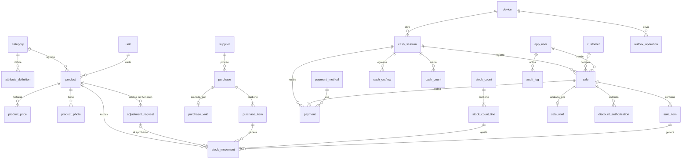

# Modelo de datos — SHT Gestión

| Campo | Valor |
|---|---|
| Versión | 1.4 |
| Fecha | 2026-10-15 |
| Estado | Vigente (aprobado al cerrar la etapa 1.0; cada etapa lo afina y aplica con migraciones) |
| Documentos relacionados | `docs/PRD.md`, `docs/arquitectura.md`, `docs/decisiones/` |

> Modelo lógico de la base de datos (Postgres). Los nombres de tablas y columnas siguen el
> glosario de `docs/arquitectura.md` (ADR-0006). Cada etapa puede afinar columnas en su
> spec; los cambios de estructura se reflejan aquí y se aplican con migraciones Alembic.

## 1. Convenciones

### 1.1 Identificadores

- Toda tabla tiene `id uuid` como clave primaria, con **UUIDv7**. Las entidades creadas
  en el mostrador (caja, venta, ítems, pagos, egresos) reciben su `id` en el equipo, para
  poder crearse sin conexión (ADR-0003).
- Los números legibles (SKU, número de venta `A-000123`, número de compra) son columnas
  aparte con restricción de unicidad.

### 1.2 Tipos de dinero y cantidades (ADR-0004)

Se definen como **dominios** de Postgres, para declarar la escala en un solo lugar:

| Dominio | Tipo | Uso |
|---|---|---|
| `usd_amount` | `NUMERIC(14,2)` | Precios de venta y montos en USD |
| `usd_cost` | `NUMERIC(18,6)` | Costos en USD (incluido el promedio ponderado) |
| `ves_amount` | `NUMERIC(16,2)` | Montos en Bs |
| `rate` | `NUMERIC(18,8)` | Tasa BCV |
| `quantity` | `NUMERIC(14,2)` | Cantidades y stock |
| `percent` | `NUMERIC(5,2)` | Porcentajes de descuento (0–100) |

### 1.3 Otras convenciones

- **Enumeraciones** como `text` con restricción `CHECK`. Agregar un valor es una
  migración simple.
- **Fechas:** los instantes son `timestamptz`; la fecha de negocio (`business_date`) es
  `date` en `America/Caracas` (arquitectura §4.2).
- **Auditoría básica:** las tablas llevan `created_at`, y `created_by` cuando la acción
  la hace un usuario.
- **Nada se borra:** productos, usuarios, proveedores, categorías, unidades y métodos de
  pago se desactivan (`is_active`).

### 1.4 Inmutabilidad (RN-12, principio II)

| Tablas | Regla |
|---|---|
| `stock_movement`, `sale`, `sale_item`, `payment`, `sale_void`, `outbox_operation`, `cash_outflow`, `cash_count`, `purchase_void`, `product_price`, `audit_log` | Solo inserción |
| `discount_authorization` | Solo pasa de `pending` a `approved` (su valor puede bajar, nunca subir) o `rejected`; no se borra (RN-07) |
| `device` | Solo se revoca una vez y su `last_sequence_number` solo avanza; no se borra |
| `customer`, `payment_method` | No se borran |
| `purchase`, `purchase_item`, `purchase_charge` | Editables y descartables en borrador; confirmadas, la compra solo pasa a `voided` sin cambiar ningún otro dato y sus líneas y gastos no cambian (RN-14, RN-20) |
| `supplier`, `charge_template`, `exchange_rate` | No se borran; la tasa se corrige (RN-15) pero no cambia de tipo ni de fecha |
| `alert` | Solo se marca como revisada (`resolved_at`, `resolved_by`); no se borra |
| `cash_session` | Los datos de apertura no cambian y no se borra; en la 1.4 solo podrá cerrarse y quedará inmutable (RF-33) |
| `adjustment_request` | Solo pasa de `pending` a un estado final (`approved`, `rejected`, `withdrawn`) sin cambiar sus datos (RN-19) |
| `stock_count`, `stock_count_line` | Inmutables una vez `applied` o `cancelled`; las líneas se anotan solo con el conteo `open` |
| `product` (columnas `stock` y `has_movements`) | Solo las cambia el trigger de `stock_movement` (RN-08) |

La regla se impone **en la base de datos**, no solo en el código: el rol de la API no
tiene permiso `DELETE` sobre estas tablas, y hay triggers que rechazan `UPDATE` (o lo
permiten solo en el estado editable). Los de la etapa 1.1b están en la migración
`0004_productos_e_inventario`, los de la 1.2 en `0005_proveedores_y_compras` y los de la
1.3 en `0006_ventas_y_caja`.

## 2. Diagrama

## 3. Tablas

### 3.1 Usuarios, equipos y control

**`app_user`** (RF-44, RF-45; `user` es palabra reservada en Postgres)

| Columna | Tipo | Notas |
|---|---|---|
| `username` | text | Único; se guarda en minúsculas (`^[a-z0-9._-]{3,30}$`) y nunca se reutiliza |
| `full_name` | text | 1–100 caracteres |
| `role` | text | `admin` \| `seller` \| `warehouse`; uno por usuario |
| `password_hash` | text | Argon2id (ADR-0005) |
| `must_change_password` | bool | Contraseña temporal asignada por el admin (RF-45) |
| `pin_hash` | text, nulo | Solo admin (`CHECK`) |
| `pin_failed_attempts`, `pin_locked_until` | int, timestamptz | 5 fallos bloquean el PIN 15 minutos |
| `is_active` | bool | |
| `last_login_at` | timestamptz, nulo | |
| `created_at`, `created_by`, `updated_at` | | `created_by` nulo en el admin inicial |

El bloqueo de inicio de sesión (5 fallos, 15 minutos) no tiene columnas: se calcula desde
`audit_log` por nombre de usuario, exista o no, para no revelar qué usuarios existen
(ADR-0008). Invariantes del servicio: siempre hay al menos un admin activo y un admin no
se desactiva a sí mismo.

**`device`** (ADR-0003; etapa 1.3, research R3)

| Columna | Tipo | Notas |
|---|---|---|
| `name` | text | 1–60 caracteres, ej. "Mostrador principal" |
| `series` | text | `^[A-Z]{1,3}$`, único y **nunca reutilizado**, incluso si el equipo se revoca (`A`, `B`, … `AA`); sale del contador `device_series` |
| `last_sequence_number` | int | Mayor correlativo registrado de la serie; solo avanza |
| `token_hash` | text | SHA-256 del token del equipo (cabecera `X-Device-Token`), único |
| `registered_by`, `registered_at` | | Admin que lo registró desde el navegador del equipo |
| `revoked_at`, `revoked_by` | nulos | Juntos y una sola vez. Las operaciones creadas antes de la revocación se aceptan |

**`user_session`** (ADR-0008): una jornada de trabajo. `user_id`, `device_id` (FK a `device`;
nulo en la 1.3, se usará para la sesión sin conexión de la 1.5), `started_at`, `expires_at` (`started_at` + 12 h, RF-44), `revoked_at`,
`revoked_reason` (`logout`, `password_changed`, `password_reset`, `user_deactivated`,
`token_reuse`), `last_seen_at`. La API la consulta en cada petición.

**`refresh_token`** (ADR-0005, ADR-0008): `session_id`, `token_hash` (SHA-256, único),
`created_at`, `rotated_at`, `replaced_by_id`. Rota en cada renovación; reutilizar uno ya
rotado revoca la jornada.

**`audit_log`** (RF-46): `occurred_at`, `user_id`, `device_id` (FK a `device`), `action` (ej.
`product.price_set`, `exchange_rate.corrected`, `sale.voided`), `entity_type`,
`entity_id`, `before` jsonb, `after` jsonb, `reason`, `details` jsonb. Se escribe en la
misma transacción que la acción y nunca guarda contraseñas ni PIN. Un trigger rechaza
`UPDATE` y `DELETE`. Las acciones de la etapa 1.1a (instalación, sesión, PIN y usuarios)
están en `specs/001-usuarios-autenticacion-permisos/data-model.md`, y las de la 1.1b
(productos, inventario y configuración) en `specs/002-productos-inventario/research.md`
R14, y las de la 1.3 (equipos, caja, descuentos y anulaciones) en
`specs/004-ventas-multimoneda/research.md` R15.

**`alert`** (RN-10, RN-14, ADR-0003): `type`, `entity_type`, `entity_id`, `details`
jsonb, `created_at`, `resolved_at`, `resolved_by` (juntos). Solo se marca como revisada.
Tipos: `purchase_void_cost` (1.2) y, de la venta (1.3, una por tipo y venta, con
`entity_type = 'sale'`): `negative_stock`, `price_mismatch`, `total_mismatch`,
`rate_mismatch`, `discount_review` e `inactive_user_sync`. Revisar una venta marcada para
revisión es resolver su alerta `discount_review`: la venta no cambia.

**`sequence_counter`** (FR-008 de la etapa 1.2): `name` (PK; `purchase` y
`device_series`), `next_number`.
Correlativo sin huecos de documentos que numera el servidor: se lee con `FOR UPDATE`
dentro de la transacción que confirma. Las ventas no lo usan: tienen series por equipo
(RN-11).

### 3.2 Productos (RF-01 a RF-07)

Detalle de columnas, reglas y triggers: `specs/002-productos-inventario/data-model.md`
(migración `0004_productos_e_inventario`).

**`category`**

| Columna | Tipo | Notas |
|---|---|---|
| `name` | text | Mangueras, Conexiones, Ferrules, Ferretería (RF-03); único entre activas |
| `sku_prefix` | text | Único, `^[A-Z]{3}$`: `MAN`, `CON`, `FER`, `FRT` (RF-02); no cambia si la categoría tiene productos (trigger) |
| `next_sku_number` | int | Contador; se lee con bloqueo de fila al crear un producto |
| `default_unit_id` | uuid → `unit` | Unidad sugerida |
| `unit_locked` | bool | `true` en Mangueras: siempre por metro (RF-05) |
| `is_active` | bool | Inactiva: no admite productos nuevos |

**`attribute_definition`** (RF-04): define qué atributos tiene cada categoría; el admin
los edita.

| Columna | Tipo | Notas |
|---|---|---|
| `category_id` | uuid → `category` | |
| `key` | text | Identificador en inglés, único por categoría (ej. `hose_type`, `thread`); no cambia |
| `label` | text | Texto en español (ej. "Tipo", "Rosca") |
| `data_type` | text | `text` \| `number` \| `option`; no cambia |
| `options` | jsonb, nulo | Si es `option`: lista de `{"value", "is_active"}`; se agregan o desactivan, nunca se borran |
| `is_required` | bool | Obligatorio al crear o editar productos |
| `is_filterable` | bool | Filtro en la búsqueda y en el catálogo (RF-36) |
| `sort_order`, `is_active` | | Desactivar no altera los valores guardados en los productos |

**`unit`** (RF-05): `code` (`m`, `u`), `name` (metro, unidad), `decimals` (2 y 0;
`CHECK` 0 o 2, no cambia), `is_active`. El admin puede agregar unidades (caja, paquete);
una unidad en uso no se desactiva.

**`product`**

| Columna | Tipo | Notas |
|---|---|---|
| `sku` | text | Único, `{prefijo}-{al menos 4 dígitos}`, generado (RF-02); cambia solo al cambiar de categoría sin movimientos |
| `category_id`, `unit_id` | uuid | Cambian solo mientras `has_movements` es falso (FR-004) |
| `name`, `description` | text | 1–120 y 0–2.000 caracteres |
| `attributes` | jsonb | Valores según `attribute_definition`; validados por la API |
| `search_text` | text | Nombre, descripción, SKU y valores de atributos normalizados sin acentos ni mayúsculas, calculado por la API (RF-06) |
| `sale_price_usd` | `usd_amount`, nulo | Precio vigente con IVA incluido (RN-17); nulo = sin precio; cada cambio crea un `product_price` |
| `avg_cost_usd` | `usd_cost`, nulo | Costo promedio ponderado (RN-09); nulo = sin costo, distinto de `0` |
| `cost_locked` | bool | La etapa 1.2 lo activa con la primera compra confirmada; desde entonces el costo inicial ya no se edita (RN-09) |
| `stock` | `quantity` | Copia del saldo del kardex; solo la cambia el trigger de `stock_movement` |
| `has_movements` | bool | Lo activa el trigger con el primer movimiento |
| `min_stock` | `quantity` | Alerta de stock bajo (RF-11), con los decimales de la unidad |
| `is_active`, `is_published` | bool | Publicar exige producto activo y con precio (`CHECK`, RF-07) |
| `updated_at`, `updated_by` | | Aviso de edición sobre datos viejos |

**`product_price`**: `product_id`, `price_usd`, `valid_from`, `set_by`. Histórico de
precios de solo inserción: sirve a la auditoría y a la validación de precios de ventas
sin conexión (ADR-0003). Previsión RN-18: las listas de precios agregarían aquí
`price_list_id` nulo (nulo = precio general).

**`product_photo`** (ADR-0009): `product_id`, `storage_path`
(`products/{producto}/{foto}.webp` en Supabase Storage), `width`, `height`, `size_bytes`,
`sort_order` (la menor es la principal), `removed_at`, `removed_by`. Máximo 5 activas.

### 3.3 Inventario (RF-08 a RF-12)

**`stock_movement`** (kardex; solo inserción)

| Columna | Tipo | Notas |
|---|---|---|
| `product_id` | uuid | |
| `type` | text | `purchase` \| `sale` \| `sale_void` \| `purchase_void` \| `adjustment` (RF-09) |
| `quantity_delta` | `quantity` | Con signo: positivo entra, negativo sale |
| `balance_after` | `quantity` | Stock resultante (RF-08); puede ser negativo (RN-10) |
| `adjustment_reason` | text, nulo | Obligatorio si `type = adjustment`: `physical_count` \| `damage` \| `loss` \| `correction` (RF-10) |
| `note` | text, nulo | Detalle libre del motivo |
| `cost_before_usd`, `cost_after_usd` | `usd_cost`, nulos | En compras y anulaciones de compra: costo promedio antes y después |
| `reference_type`, `reference_id` | text, uuid | `sale_item`, `purchase_item`, `stock_count_line`, … |
| `occurred_at` | timestamptz | |
| `created_by`, `device_id` | uuid | |

Un trigger `BEFORE INSERT` verifica `balance_after = stock + quantity_delta` y actualiza
`product.stock`; otro rechaza `UPDATE` y `DELETE`. La API solo escribe movimientos con
`services/inventory.py::post_movement`.

**`adjustment_request`** (RN-19): salida de inventario del Almacén que espera la decisión
del Admin. `product_id`, `quantity_delta` (`< 0`), `adjustment_reason`, `note`, `status`
(`pending` \| `approved` \| `rejected` \| `withdrawn`), `requested_by`, `requested_at`,
`decided_by`, `decided_at`, `rejection_reason` (obligatorio si `rejected`) y
`stock_movement_id` (obligatorio si `approved`). Mientras está pendiente no toca el stock;
al aprobarla se revalida con el stock del momento.

**`stock_count`** (RF-12, RN-19): `status` (`open` \| `ready_for_review` \| `applied` \|
`cancelled`), `scope` jsonb (todo, categorías o productos), `notes`, `started_by`,
`started_at`, `ready_by`, `ready_at`, `closed_by`, `closed_at`, `cancel_reason`
(obligatorio si `cancelled`). Solo el Admin aplica; el Almacén abre, anota, marca listo y
cancela conteos abiertos.

**`stock_count_line`**: `stock_count_id`, `product_id`, `counted_quantity`,
`expected_quantity`, `counted_by`, `counted_at`, `stock_movement_id`, `is_open`. Al
anotar se guarda el stock del sistema de ese momento en `expected_quantity` y la
diferencia se calcula contra él: las compras o ventas ocurridas durante el conteo se
conservan sin duplicarse. Al aplicar, cada diferencia genera un ajuste con motivo
`physical_count` (puede dejar saldo negativo, que se informa). El Almacén cuenta a
ciegas: no recibe `expected_quantity` ni la diferencia.

### 3.4 Compras (RF-13 a RF-16, RN-14, RN-20)

**`supplier`**: `name` (1–120), `rif` (único, nulo; normalizado `X-NNNNNNNN-N`), `phone`,
`notes`, `is_active`.

**`purchase`**

| Columna | Tipo | Notas |
|---|---|---|
| `number` | text, nulo | Único, correlativo `C-000001` asignado **al confirmar**, sin huecos (las compras se registran con conexión) |
| `supplier_id` | uuid | |
| `purchase_date` | date | Fecha de negocio de la compra |
| `currency` | text | `USD` \| `VES` (RF-15) |
| `exchange_rate` | `rate`, nulo | Tasa BCV usada (RN-05): la de la fecha de la compra o la última anterior. Obligatoria si la compra es en Bs o tiene gastos en Bs; en las demás, se guarda si existe |
| `exchange_rate_date` | date, nulo | Fecha de la tasa usada (puede ser anterior a `purchase_date`) |
| `supplier_invoice_number` | text, nulo | Número de factura del proveedor; se advierte si se repite con el mismo proveedor |
| `merchandise_total_usd` | `usd_amount` | Σ `line_total_usd` |
| `charges_total_usd` | `usd_amount` | Σ `purchase_charge.amount_usd` (RN-20) |
| `total_usd` | `usd_amount` | Mercancía + gastos |
| `merchandise_total_ves` | `ves_amount`, nulo | Solo si la compra es en Bs: total de la mercancía en Bs |
| `status` | text | `draft` \| `confirmed` \| `voided` |
| `confirmed_by`, `confirmed_at` | | |
| `notes` | text | |

**`purchase_item`**: `purchase_id`, `product_id`, `line_number`, `quantity`, `unit_cost_ves`
(`ves_amount`, nulo), `unit_cost_usd` (`usd_cost`; en compras en Bs = costo Bs ÷ tasa,
6 decimales), `line_total_ves` (nulo), `line_total_usd`, `allocated_charges_usd` (`usd_amount`; parte de los
gastos que le toca por valor) y `landed_unit_cost_usd` (`usd_cost`; costo final por
unidad = `unit_cost_usd` + `allocated_charges_usd` ÷ `quantity`, el que entra al costo
promedio, RN-20). Una línea por producto en cada compra.

**`purchase_charge`** (RN-20): `purchase_id`, `line_number`, `description`, `charge_type` (`percent` \|
`fixed`), `percent` (`NUMERIC(5,2)`, nulo; > 0 y ≤ 100, solo si `percent`), `amount`
(nulo; solo si `fixed`), `currency` (`USD` \| `VES`; solo si `fixed`), `amount_usd`
(`usd_amount`), `allocation_method` (`value`; admite otros métodos a futuro) y
`charge_template_id` (nulo). Los `CHECK` exigen los campos según el tipo.

**`charge_template`** (gastos frecuentes, RF-14): `name`, `charge_type`, `default_value`
(nulo), `currency` (si es `fixed`), `is_active`. Solo el Admin la edita; nunca se borra.
La compra copia sus datos, así que editarla no cambia compras existentes.

**`purchase_void`** (RN-14): `purchase_id` (único), `reason`, `voided_by`, `voided_at`.
Genera movimientos `purchase_void` inversos y recalcula el costo con
`landed_unit_cost_usd`; si el resultado no es válido, conserva el costo y crea una alerta
`purchase_void_cost`. La compra pasa a `voided`.

### 3.5 Tasa de cambio (RF-17, RF-18, RN-15)

**`exchange_rate`**: `rate_type` (`BCV`; admite otros a futuro, RN-03), `business_date`,
`rate`, `created_by`, `created_at`, `updated_by`, `updated_at`. Único por
`(rate_type, business_date)`. La carga se adelantó de la etapa 1.3 a la 1.2 para las
compras en Bs; una compra usa la tasa de su fecha o la última anterior.
Es la única tabla de valores monetarios que admite corrección (RN-15); cada corrección
queda en `audit_log` con el valor anterior y el nuevo. Las ventas, pagos y compras
**copian** el valor de la tasa, así que una corrección no las altera.

### 3.6 Ventas (RF-20 a RF-28; etapa 1.3)

Detalle en `specs/004-ventas-multimoneda/data-model.md`. Las tablas marcadas "id del
equipo" reciben el UUIDv7 generado en el navegador (ADR-0003).

**`customer`** (RF-28; id del equipo): `name` (2–100), `document_id` (cédula
`^[VE]-\d{6,8}$` o RIF `^[JGVEPC]-\d{8}-\d$`, único y opcional; con `V` o `E` sin guiones
es siempre cédula), `phone` (hasta 30), `created_at`, `created_by`. Un documento repetido
liga la venta al cliente existente. En la Fase 2 se agregan los datos de crédito.

**`payment_method`** (RF-24): catálogo fijo con `code` como clave, `name`, `currency`
(`VES` \| `USD` \| `USDT`), `requires_reference`, `is_cash`, `sort_order`.

| `code` | Nombre | Moneda | Referencia | Efectivo |
|---|---|---|:-:|:-:|
| `cash_ves` | Efectivo Bs | VES | ❌ | ✅ |
| `mobile_payment` | Pago móvil / transferencia | VES | ✅ | ❌ |
| `pos_card` | Punto de venta | VES | ✅ | ❌ |
| `cash_usd` | Efectivo USD | USD | ❌ | ✅ |
| `zelle` | Zelle | USD | ✅ | ❌ |
| `binance_usdt` | Binance USDT | USDT | ✅ | ❌ |

**`sale`** (RF-26; id del equipo; solo inserción)

| Columna | Tipo | Notas |
|---|---|---|
| `device_id`, `series`, `sequence_number` | | Único `(series, sequence_number)` (RN-11) |
| `number` | text | `A-000123`, derivado de serie y correlativo; único |
| `cash_session_id` | uuid | Caja abierta del equipo (RF-30, RN-16) |
| `seller_id` | uuid → `app_user` | En la 1.3, el usuario de la sesión que la envía |
| `customer_id` | uuid, nulo | |
| `occurred_at`, `business_date`, `synced_at` | | Hora del equipo, día de negocio (Caracas) y llegada |
| `exchange_rate`, `exchange_rate_date` | `rate`, date | Copia de la tasa usada (RN-05); si no coincide con la cargada, alerta `rate_mismatch` |
| `subtotal_usd` | `usd_amount` | Σ (subtotal de línea − descuento propio) |
| `discount_type`, `discount_value`, `discount_usd` | | Descuento sobre el total (RF-22) |
| `discount_authorized_by`, `discount_authorization_method`, `discount_authorization_id` | nulos | `pin` \| `request` \| `admin_self`; la autorización es única |
| `total_usd`, `total_ves` | | `total_ves = total_usd × tasa`, redondeado (RN-02) |
| `paid_usd`, `change_usd` | `usd_amount` | Lo pagado y el vuelto en USD; el sobrepago es la diferencia |
| `device_total_usd` | `usd_amount` | Total calculado en el equipo, para detectar diferencias |
| `needs_review` | bool | Descuento de Vendedor sin autorización válida (RN-07) |
| `outbox_operation_id` | uuid | Operación de la cola que la creó (única) |

**`sale_item`** (id del equipo; solo inserción): `sale_id`, `line_number`, `product_id`
(RN-13), `quantity` (> 0, en la unidad del producto; ya convertida de cm, RF-21),
`entered_unit` (`m` \| `cm` \| `unit`), `unit_price_usd` (el del equipo),
`server_price_usd` (el vigente si era distinto), `line_subtotal_usd`, descuento propio
(`item_discount_type`, `item_discount_value`, `item_discount_usd`) con su autorizante,
método y autorización única, `allocated_sale_discount_usd` (ADR-0004), `line_total_usd`
(≥ 0) y `unit_cost_usd` (costo promedio al registrarse, solo Admin, RF-42).

**`discount_authorization`** (RN-07, RF-22): una sola tabla para las autorizaciones por
PIN y las solicitudes (reemplaza a la `discount_request` prevista). `sale_id` y
`sale_item_id` (ids del equipo de la venta en curso), `product_id`, `discount_type`,
`requested_value`, `discount_value` (≤ pedido; el Admin puede aprobar uno menor),
`base_usd`, `discount_usd`, `method` (`pin` \| `request`), `status` (`pending` \|
`approved` \| `rejected`), `requested_by`, `requested_at`, `device_id`, `decided_by`,
`decided_at`, `rejection_reason`.

**`payment`** (RF-23 a RF-25; solo inserción)

| Columna | Tipo | Notas |
|---|---|---|
| `sale_id`, `line_number` | | Único `(sale_id, kind, line_number)` |
| `cash_session_id` | uuid | Caja donde entra o sale el dinero |
| `kind` | text | `sale_payment` (entra) \| `change` (vuelto, sale) \| `void_refund` (sale) \| `void_change` (entra) |
| `payment_method_code` | text → `payment_method` | |
| `currency`, `amount` | | Moneda del método y monto positivo |
| `exchange_rate` | `rate` | Copia de la tasa de la venta (RN-05) |
| `amount_usd` | `usd_amount` | Bs ÷ tasa (RN-06) o 1:1 (RN-04) |
| `reference` | text, nulo | 1–60 caracteres; un trigger la exige si el método la requiere (RF-24) |
| `sale_void_id` | uuid, nulo | Solo en `void_refund` y `void_change` |

**`sale_void`** (RF-27; solo inserción): `sale_id` (único), `reason` (5–500),
`voided_by`, `voided_at`. Genera movimientos de kardex `sale_void` y el espejo de cada
pago (`void_refund`) y vuelto (`void_change`) en la caja de la venta. En qué caja se
revierte el dinero si la de la venta ya está cerrada se decide en la etapa 1.4 (PRD §10).

### 3.7 Caja (RF-29 a RF-33, RN-16)

**`cash_session`** (id del equipo; apertura desde la etapa 1.3)

| Columna | Tipo | Notas |
|---|---|---|
| `device_id` | uuid | Como máximo una abierta por equipo (índice único parcial) |
| `business_date` | date | |
| `opened_by`, `opened_at` | | Quien la abre responde por ella (RN-16) |
| `opening_float_ves`, `opening_float_usd` | | Fondo inicial ≥ 0 (RF-29) |
| `status` | text | `open` (la 1.4 agrega `closed`, `closed_by`, `closed_at`) |
| `outbox_operation_id` | uuid | Operación de la cola que la abrió |

**`cash_outflow`** (RF-32, etapa 1.4): `cash_session_id`, `payment_method_id` (método en
efectivo), `amount`, `reason`, `created_by`, `occurred_at`.

**`cash_count`** (RF-31, etapa 1.4): una fila por método al cerrar: `cash_session_id`,
`payment_method_id`, `expected_amount`, `counted_amount`, `difference`.

**Esperado por método** = fondo inicial (solo efectivo) + Σ `sale_payment` − Σ `change`
− Σ `void_refund` + Σ `void_change` − Σ `cash_outflow`, en la moneda del método.

### 3.8 Sincronización (ADR-0003)

**`outbox_operation`** (solo inserción): `id` (UUIDv7 del equipo = clave de
idempotencia), `device_id`, `user_id` (quien la envió), `operation_type`
(`cash_session.open`, `sale.create`; la 1.4 y la 1.5 suman tipos), `schema_version`,
`payload` jsonb, `created_at_device`, `received_at`, `processed_at`, `status`
(`processed` \| `rejected`), `http_status`, `result` jsonb o `error` jsonb. La fila se
inserta con su resultado en la misma transacción que la operación; un reenvío devuelve la
respuesta guardada, también la de un rechazo.

## 4. Restricciones e índices clave

- Únicos: `app_user.username`, `device.series`, `category.sku_prefix`, `product.sku`,
  `(sale.series, sale.sequence_number)`, `purchase.number`,
  `(exchange_rate.rate_type, business_date)`, `sale.number`, `sale_void.sale_id`,
  `purchase_void.purchase_id`, `customer.document_id`, `supplier.rif`,
  `device.token_hash`, `sale.discount_authorization_id`,
  `sale_item.item_discount_authorization_id`.
- Único parcial: una `cash_session` con `status = 'open'` por `device_id`; una
  `stock_count_line` con `is_open` por producto (un producto en un solo conteo abierto);
  `lower(category.name)` entre categorías activas.
- `CHECK`: cantidades positivas en ítems y compras; `adjustment_reason` obligatorio en
  ajustes; porcentajes entre 0 y 100. La referencia obligatoria según el método la impone
  un trigger sobre `payment` (depende de `payment_method`).
- Decimales permitidos por unidad (`unit.decimals`): validados en la API.
- Índices: `stock_movement (product_id, occurred_at DESC)`, `product (category_id,
  is_active)`, `product (is_active, stock)`, `adjustment_request (status, requested_at)`,
  `sale (business_date DESC, occurred_at DESC)`, `sale (seller_id, business_date)`,
  `sale_item (product_id)`, `payment (cash_session_id)`,
  `discount_authorization (requested_at) WHERE status = 'pending'`,
  `purchase (status, purchase_date DESC)`, `purchase (supplier_id, purchase_date DESC)`,
  `purchase_item (product_id)`, `exchange_rate (rate_type, business_date DESC)` y
  `alert (created_at DESC) WHERE resolved_at IS NULL`.
- Búsqueda (RF-06): sin índice ni extensiones. Con ~1.000 productos, un recorrido con
  `LIKE` sobre `product.search_text` responde en milisegundos; si el catálogo supera
  ~10.000 productos se agrega un índice `pg_trgm` sin cambiar la API (arquitectura §5).

## 5. Previsiones para fases posteriores

No se implementan ahora; el modelo actual las permite sin rediseño.

**Fase 3 — Facturación fiscal (IVA e IGTF)**

- **IVA:** se agregará la alícuota por producto (general, reducida, exento). Como los
  precios incluyen IVA (RN-17), la base imponible de cada línea se obtiene de
  `line_total_usd`, que ya incluye el descuento total repartido, así que el desglose es
  correcto por línea.
- **IGTF:** cada pago guarda método, moneda y monto, que es lo que necesita el cálculo
  del impuesto a las transacciones en divisas.
- **Factura:** una tabla `fiscal_document` vinculada a la venta (número fiscal, número de
  control, medio de emisión). La venta y su número interno no cambian.
- **Cliente:** `customer.document_id` ya guarda la cédula o el RIF.

**Fase 2 — Crédito y nota de entrega**

- Crédito: datos de crédito en `customer`, un método o tipo de pago "crédito" y tablas de
  cuentas por cobrar y abonos (con tasa del día del abono, RF-49).
- Nota de entrega: se genera a partir de `sale`, `sale_item` y `payment`, que ya tienen
  todos los datos de RF-51.

## 6. Volumen estimado

Con ~1.000 productos y, por ejemplo, 50 ventas diarias de 4 ítems, se generan unas
75.000 líneas de venta y otros tantos movimientos de kardex por año. Son pocos megabytes
anuales, holgadamente dentro de los 500 MB de Supabase Free. Las fotos comprimidas son
el principal consumo de almacenamiento (1 GB en Free).
