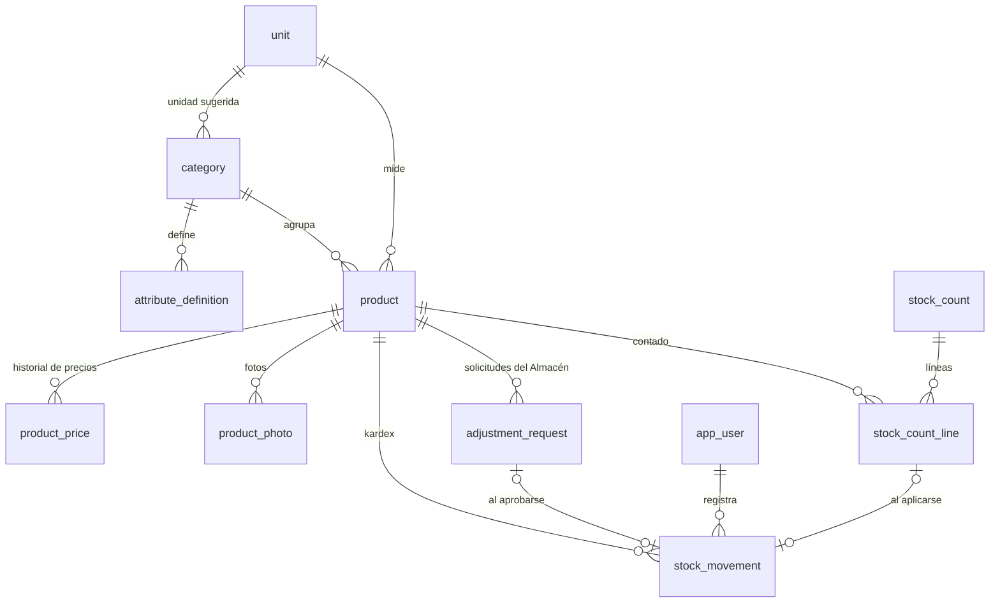
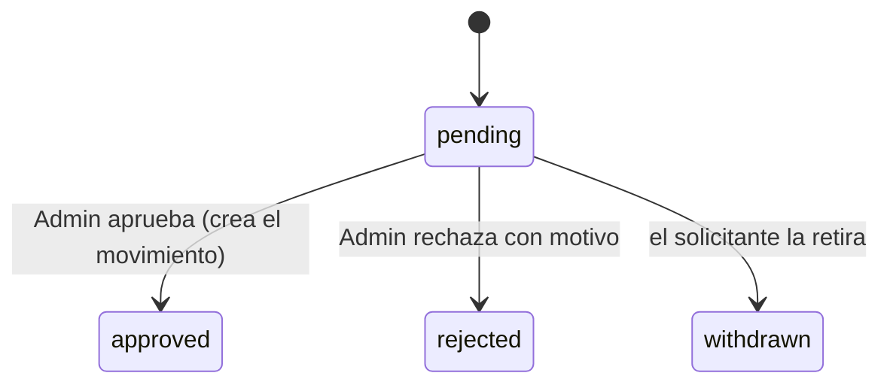
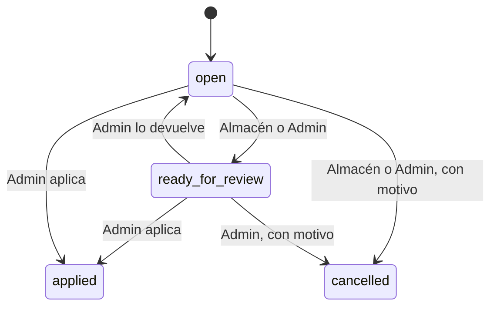

# Modelo de datos: productos, categorías e inventario

Tablas de la migración `0004_productos_e_inventario`. Afina `docs/modelo-de-datos.md`
§3.2 y §3.3, que se actualiza al cerrar la etapa. Convenciones del modelo (§1): `id`
UUIDv7, dominios decimales de ADR-0004, enumeraciones como `text` con `CHECK`,
`created_at`/`created_by`, nada se borra. El rol `sht_api` no tiene `DELETE` en ninguna
tabla.

## Diagrama

## Tablas

### `unit` (RF-05, FR-031)

| Columna | Tipo | Reglas |
|---|---|---|
| `code` | text | Único, 1–10 caracteres en minúscula (`m`, `u`, `caja`) |
| `name` | text | Único (metro, unidad) |
| `decimals` | smallint | `CHECK (decimals IN (0, 2))`; inmutable (no está en `PATCH /units`) |
| `is_active` | bool | Una unidad en uso no se desactiva si hay productos activos que la usan |
| `created_at`, `created_by` | | |

Datos iniciales: `m` metro 2; `u` unidad 0.

### `category` (RF-02, RF-03, FR-029)

| Columna | Tipo | Reglas |
|---|---|---|
| `name` | text | Único entre activas, 1–60 caracteres |
| `sku_prefix` | text | Único, `^[A-Z]{3}$`; inmutable si la categoría tiene productos (trigger) |
| `next_sku_number` | int | `>= 1`; se lee con `FOR UPDATE` al crear un producto (R1) |
| `default_unit_id` | uuid → `unit` | Unidad sugerida |
| `unit_locked` | bool | `true` en Mangueras: los productos usan siempre `default_unit_id` (FR-005) |
| `is_active` | bool | Inactiva: no admite productos nuevos |
| `created_at`, `created_by`, `updated_at` | | |

Datos iniciales: Mangueras `MAN` (metro, bloqueada), Conexiones `CON`, Ferrules `FER`,
Ferretería `FRT` (unidad).

### `attribute_definition` (RF-04, FR-030)

| Columna | Tipo | Reglas |
|---|---|---|
| `category_id` | uuid → `category` | |
| `key` | text | `^[a-z][a-z0-9_]{1,39}$`, único por categoría, inmutable |
| `label` | text | Texto en español |
| `data_type` | text | `text` \| `number` \| `option`; inmutable (no está en `PATCH /attributes`) |
| `options` | jsonb, nulo | Obligatorio si `option`: lista de `{"value": text, "is_active": bool}`, valores únicos |
| `is_required` | bool | |
| `is_filterable` | bool | Filtro en la búsqueda y en el catálogo (RF-36) |
| `sort_order` | smallint | |
| `is_active` | bool | Desactivar no altera valores guardados |

Datos iniciales: research R5.

### `product` (RF-01, FR-001 a FR-015)

| Columna | Tipo | Reglas |
|---|---|---|
| `sku` | text | Único, generado (R1); no está en ningún esquema de entrada |
| `category_id` | uuid → `category` | Cambia solo sin movimientos (FR-004) |
| `unit_id` | uuid → `unit` | Cambia solo sin movimientos; fija si `category.unit_locked` |
| `name` | text | 1–120 caracteres, recortado |
| `description` | text | 0–2.000 caracteres |
| `attributes` | jsonb | `{key: valor}` validado contra `attribute_definition` (R5) |
| `search_text` | text | Normalizado por el backend (R4) |
| `sale_price_usd` | `usd_amount`, nulo | `> 0`; nulo = sin precio. Solo por `product_price` (R6) |
| `avg_cost_usd` | `usd_cost`, nulo | `>= 0`; nulo = sin costo, distinto de `0` |
| `cost_locked` | bool | `false`; la etapa 1.2 lo pone en `true` con la primera compra confirmada |
| `stock` | `quantity` | `0` al crear; solo lo cambia el trigger de `stock_movement` (R2) |
| `min_stock` | `quantity` | `>= 0`, decimales según la unidad |
| `has_movements` | bool | `true` desde el primer movimiento (lo marca el trigger); habilita las restricciones de FR-004 |
| `is_active` | bool | |
| `is_published` | bool | `CHECK (NOT is_published OR (is_active AND sale_price_usd IS NOT NULL))` (FR-009) |
| `created_at`, `created_by`, `updated_at`, `updated_by` | | |

Índices: `UNIQUE (sku)`, `(category_id, is_active)`, `(is_active, stock)`.

### `product_price` (FR-012; solo inserción)

| Columna | Tipo | Reglas |
|---|---|---|
| `product_id` | uuid → `product` | |
| `price_usd` | `usd_amount` | `> 0` |
| `valid_from` | timestamptz | |
| `set_by` | uuid → `app_user` | |

Trigger que rechaza `UPDATE`. Previsión RN-18: `price_list_id` nulo se agregaría aquí.

### `product_photo` (FR-008)

| Columna | Tipo | Reglas |
|---|---|---|
| `product_id` | uuid → `product` | |
| `storage_path` | text | `products/{product_id}/{id}.webp` |
| `width`, `height`, `size_bytes` | int | Del WebP guardado |
| `sort_order` | smallint | La menor es la principal |
| `removed_at`, `removed_by` | nulos | Quitar = marcar y borrar el objeto de Storage |
| `created_at`, `created_by` | | |

Regla de servicio: máximo 5 fotos con `removed_at IS NULL` por producto, con bloqueo del
producto al agregar.

### `stock_movement` (RF-08, RF-09; solo inserción)

| Columna | Tipo | Reglas |
|---|---|---|
| `product_id` | uuid → `product` | |
| `type` | text | `purchase` \| `sale` \| `sale_void` \| `purchase_void` \| `adjustment` |
| `quantity_delta` | `quantity` | `<> 0` |
| `balance_after` | `quantity` | El trigger verifica `= stock anterior + delta` (R2) |
| `adjustment_reason` | text, nulo | Obligatorio si `type = 'adjustment'`: `physical_count` \| `damage` \| `loss` \| `correction` |
| `note` | text, nulo | Hasta 500 caracteres |
| `cost_before_usd`, `cost_after_usd` | `usd_cost`, nulos | Para la etapa 1.2 |
| `reference_type`, `reference_id` | text, uuid, nulos | `adjustment_request`, `stock_count_line` (y en etapas siguientes `purchase_item`, `sale_item`…) |
| `occurred_at` | timestamptz | |
| `created_by` | uuid → `app_user` | Quien ejecuta (en una aprobación, el Admin) |
| `device_id` | uuid, nulo | Para la etapa 1.3 |

Triggers: `BEFORE INSERT` (verifica saldo, actualiza `product.stock` y
`product.has_movements`), y rechazo de `UPDATE`/`DELETE`. Índice
`(product_id, occurred_at DESC)`.

### `adjustment_request` (FR-019a, RN-19)

| Columna | Tipo | Reglas |
|---|---|---|
| `product_id` | uuid → `product` | |
| `quantity_delta` | `quantity` | `< 0` |
| `adjustment_reason` | text | `damage` \| `loss` \| `correction` \| `physical_count` |
| `note` | text, nulo | |
| `status` | text | `pending` \| `approved` \| `rejected` \| `withdrawn` |
| `requested_by`, `requested_at` | | Usuario de Almacén |
| `decided_by`, `decided_at` | nulos | Admin (aprobación o rechazo) o el mismo solicitante (retiro) |
| `rejection_reason` | text, nulo | Obligatorio si `rejected` |
| `stock_movement_id` | uuid → `stock_movement`, nulo | Obligatorio si `approved` |

Transiciones (trigger): solo desde `pending` hacia un estado final; los demás campos no
cambian. Índice `(status, requested_at)`.

### `stock_count` (RF-12, FR-024 a FR-027)

| Columna | Tipo | Reglas |
|---|---|---|
| `status` | text | `open` \| `ready_for_review` \| `applied` \| `cancelled` |
| `scope` | jsonb | `{"type": "all"}`, `{"type": "categories", "ids": […]}` o `{"type": "products", "ids": […]}` |
| `notes` | text, nulo | |
| `started_by`, `started_at` | | |
| `ready_by`, `ready_at` | nulos | Último paso a revisión |
| `closed_by`, `closed_at` | nulos | Quien aplicó o canceló |
| `cancel_reason` | text, nulo | Obligatorio si `cancelled` |

Trigger: sin cambios una vez `applied` o `cancelled`.

Alcance (FR-024): con `all` y `categories` entran los productos activos y los inactivos
con stock distinto de cero; con `products`, los elegidos, activos o no.

### `stock_count_line`

| Columna | Tipo | Reglas |
|---|---|---|
| `stock_count_id` | uuid → `stock_count` | |
| `product_id` | uuid → `product` | Único por conteo |
| `counted_quantity` | `quantity`, nulo | `>= 0`, decimales según la unidad |
| `expected_quantity` | `quantity`, nulo | Stock al anotar (FR-025); nunca se envía al Almacén |
| `counted_by`, `counted_at` | nulos | |
| `stock_movement_id` | uuid, nulo | El ajuste generado al aplicar |
| `is_open` | bool | `true` mientras el conteo no se aplica ni cancela; pasa a `false` al aplicar y al cancelar |

Índice único parcial `(product_id) WHERE is_open` (FR-024). Trigger:

- `counted_quantity`, `expected_quantity`, `counted_by` y `counted_at` solo cambian con
  el conteo `open`.
- `is_open` (solo de `true` a `false`) y `stock_movement_id` solo cambian con el conteo
  `open` o `ready_for_review`: es el cierre al aplicar o cancelar. El servicio cierra
  las líneas antes de cambiar el estado del conteo.
- Con el conteo `applied` o `cancelled`, nada cambia.

## Reglas transversales

- **Decimales:** cantidades validadas con los decimales de la unidad (R3); precios con 2
  y `> 0`; costo inicial con hasta 6 y `>= 0`. En JSON, siempre como cadenas.
- **Stock negativo:** un ajuste manual o aprobado no puede dejarlo negativo; un ajuste
  por conteo sí (FR-026).
- **Auditoría:** cada operación de R14 escribe `audit_log` en la misma transacción.
- **Previsión Fase 3:** la alícuota de IVA por producto se agregará como columna de
  `product` (o tabla de alícuotas) sin tocar lo anterior.

## Cambios a `docs/modelo-de-datos.md`

- §3.2: `search_text` pasa a `text` normalizado (R4); `sale_price_usd` y `avg_cost_usd`
  nulos; nuevas `cost_locked` y `has_movements`; `attribute_definition` suma
  `is_required` y el formato de `options`; `product_photo` suma `removed_at` y
  dimensiones.
- §3.3: nueva tabla `adjustment_request`; `stock_count` suma `ready_for_review`,
  `scope` y campos de cierre; `stock_count_line` suma `counted_by`, `counted_at`,
  `stock_movement_id` e `is_open`, y la regla de ventas durante el conteo (FR-025).
- §1.4: `product_price`, `stock_movement` de solo inserción (ya estaban);
  `adjustment_request`, `stock_count` y `stock_count_line` con su regla de estados.
- §4: índices de búsqueda sin trigram (R4); índice único parcial de líneas abiertas.
