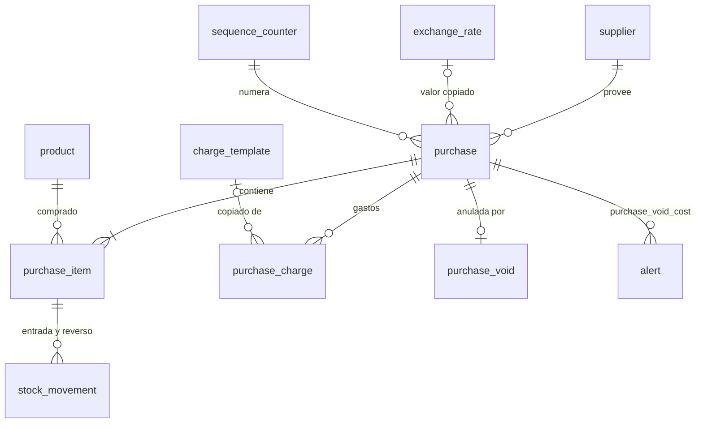
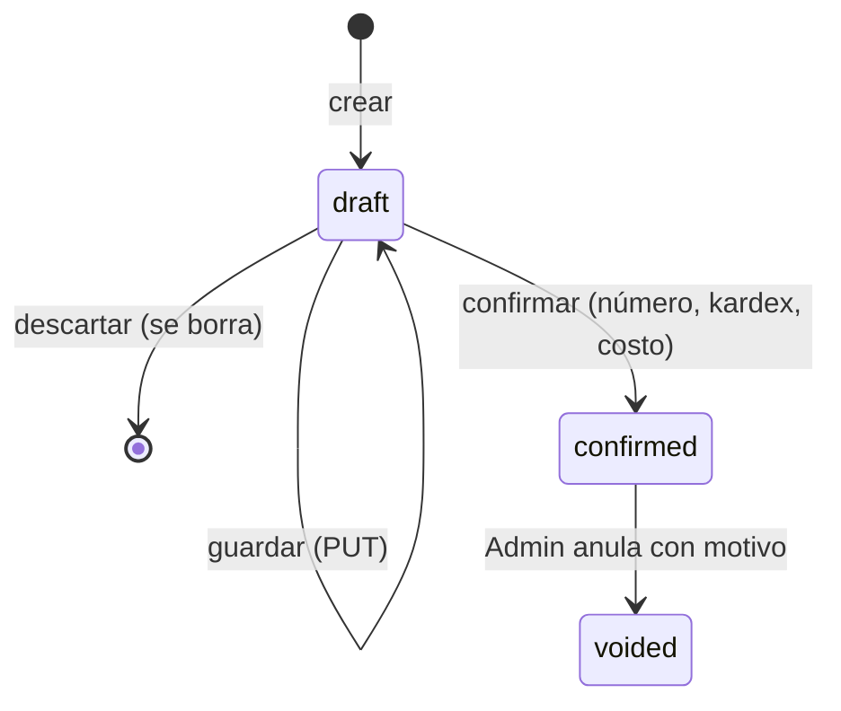

# Modelo de datos: proveedores, compras con gastos y tasa BCV

Tablas de la migración `0005_proveedores_y_compras`. Afinan `docs/modelo-de-datos.md`
§3.1 (alertas), §3.4 (compras) y §3.5 (tasa). Convenciones del modelo (§1):

- `id` UUIDv7;
- dominios decimales de ADR-0004 (`usd_amount`, `usd_cost`, `ves_amount`, `rate`,
  `quantity`, `percent`);
- enumeraciones como `text` con `CHECK`;
- `created_at` y `created_by` en todas las tablas;
- nada se borra, salvo los borradores de compra (R2).

## Diagrama

## Tablas

### `supplier` (RF-13, FR-001 a FR-003)

| Columna | Tipo | Reglas |
|---|---|---|
| `name` | text | 1–120 caracteres, obligatorio |
| `rif` | text, nulo | Normalizado `^[JGVEPC]-\d{8}-\d$` (R5); índice único (los nulos no chocan) |
| `phone` | text, nulo | Hasta 30 caracteres |
| `notes` | text, nulo | Hasta 1.000 caracteres |
| `is_active` | bool | Inactivo: no se ofrece en compras nuevas ni permite confirmar borradores |
| `created_at`, `created_by`, `updated_at` | | |

Nunca se borra (trigger que rechaza `DELETE`).

### `exchange_rate` (RF-17, RN-03, RN-15; FR-025 a FR-028)

| Columna | Tipo | Reglas |
|---|---|---|
| `rate_type` | text | `BCV` (`CHECK`; admite otros a futuro) |
| `business_date` | date | No futura (se valida en el servicio con la hora de Caracas) |
| `rate` | `rate` | `> 0`, hasta 8 decimales |
| `created_by`, `created_at` | | Quién la cargó |
| `updated_by`, `updated_at` | nulos | Última corrección |

Único `(rate_type, business_date)`. Trigger que rechaza `DELETE` y cambios de
`rate_type` o `business_date`. La tasa aplicable a una fecha es la de mayor
`business_date <= fecha` (R6). Índice `(rate_type, business_date DESC)`.

### `charge_template` (gastos frecuentes, RF-14; FR-032)

| Columna | Tipo | Reglas |
|---|---|---|
| `name` | text | 1–80 caracteres; único entre activas (`lower(name)`) |
| `charge_type` | text | `percent` \| `fixed` |
| `default_value` | numeric, nulo | Si `percent`: `percent` > 0; si `fixed`: monto > 0 con 2 decimales |
| `currency` | text, nulo | `USD` \| `VES`; obligatorio si `fixed`, nulo si `percent` |
| `is_active` | bool | |
| `created_at`, `created_by`, `updated_at` | | |

Nunca se borra (trigger que rechaza `DELETE`).

### `purchase` (RF-14 a RF-16; FR-004 a FR-016)

| Columna | Tipo | Reglas |
|---|---|---|
| `number` | text, nulo | `C-000001`; se asigna al confirmar (R3); único |
| `supplier_id` | uuid → `supplier` | |
| `purchase_date` | date | Fecha de la factura; no futura |
| `supplier_invoice_number` | text, nulo | Hasta 50 caracteres |
| `currency` | text | `USD` \| `VES` |
| `exchange_rate` | `rate`, nulo | Copia de la tasa aplicable (R6); obligatoria si `currency = 'VES'` o hay gastos en Bs |
| `exchange_rate_date` | date, nulo | Fecha de esa tasa; nula si y solo si `exchange_rate` es nula |
| `merchandise_total_usd` | `usd_amount` | Σ `purchase_item.line_total_usd` |
| `merchandise_total_ves` | `ves_amount`, nulo | Σ `line_total_ves`; solo si `currency = 'VES'` |
| `charges_total_usd` | `usd_amount` | Σ `purchase_charge.amount_usd`; `0` sin gastos |
| `total_usd` | `usd_amount` | Mercancía + gastos |
| `status` | text | `draft` \| `confirmed` \| `voided` |
| `notes` | text, nulo | Hasta 1.000 caracteres |
| `created_by`, `created_at`, `updated_at` | | |
| `confirmed_by`, `confirmed_at` | nulos | Obligatorios si `status <> 'draft'` (`CHECK`) |

Índices:

- `(status, purchase_date DESC)`;
- `(supplier_id, purchase_date DESC)`;
- único `number`;
- `(supplier_id, lower(supplier_invoice_number))` para el aviso de duplicado.

Trigger `purchase_guard` (R2): en `draft` se edita y se borra; `confirmed → voided`
solo cambia `status`; ninguna otra transición ni cambio.

### `purchase_item` (FR-004, FR-006, FR-007, FR-031)

| Columna | Tipo | Reglas |
|---|---|---|
| `purchase_id` | uuid → `purchase` | |
| `product_id` | uuid → `product` | Único por compra |
| `line_number` | int | Orden de la pantalla; el reparto desempata por el menor |
| `quantity` | `quantity` | `> 0`, con los decimales de la unidad (validado en el servicio) |
| `unit_cost_ves` | `ves_amount`, nulo | Obligatorio si la compra es en Bs; `> 0` |
| `unit_cost_usd` | `usd_cost` | `> 0`; en Bs = `unit_cost_ves ÷ tasa` (6 decimales) |
| `line_total_ves` | `ves_amount`, nulo | `quantity × unit_cost_ves` (2 decimales) |
| `line_total_usd` | `usd_amount` | `quantity × unit_cost_usd` (2 decimales) |
| `allocated_charges_usd` | `usd_amount` | Parte de los gastos por valor (R1); `>= 0` |
| `landed_unit_cost_usd` | `usd_cost` | `unit_cost_usd + allocated_charges_usd ÷ quantity` (6 decimales) |

Trigger `purchase_child_guard`: inserción, cambio y borrado solo con la compra en
`draft`. Índice `(product_id)`.

### `purchase_charge` (RN-20; FR-029 a FR-031)

| Columna | Tipo | Reglas |
|---|---|---|
| `purchase_id` | uuid → `purchase` | |
| `line_number` | int | Orden de la pantalla |
| `description` | text | 1–120 caracteres |
| `charge_type` | text | `percent` \| `fixed` |
| `percent` | `percent`, nulo | `> 0`; obligatorio si y solo si `percent` |
| `amount` | numeric(16,2), nulo | `> 0`; obligatorio si y solo si `fixed` |
| `currency` | text, nulo | `USD` \| `VES`; obligatorio si y solo si `fixed` |
| `amount_usd` | `usd_amount` | Calculado (R1) |
| `allocation_method` | text | `value` (`CHECK`; admite otros a futuro) |
| `charge_template_id` | uuid → `charge_template`, nulo | Solo referencia; la compra no lo lee al calcular |

Trigger `purchase_child_guard`, igual que en las líneas.

### `purchase_void` (RN-14; FR-017, FR-018)

| Columna | Tipo | Reglas |
|---|---|---|
| `purchase_id` | uuid → `purchase` | Único |
| `reason` | text | 5–500 caracteres |
| `voided_by`, `voided_at` | | Admin |

Solo inserción (`reject_change()` de `0004`).

### `alert` (RN-14; FR-018; R8)

| Columna | Tipo | Reglas |
|---|---|---|
| `type` | text | `purchase_void_cost` (`CHECK` ampliable en la 1.3 y la 1.5) |
| `entity_type`, `entity_id` | text, uuid | `purchase` y su id |
| `details` | jsonb | `{purchase_number, product_id, sku, stock_before, stock_after, cost_kept, cost_computed}` |
| `created_at` | timestamptz | |
| `resolved_at`, `resolved_by` | nulos | Juntos (`CHECK`) |

Trigger: solo se actualizan `resolved_at` y `resolved_by` (de nulos a valores); no se
borra. Índice parcial `(created_at DESC) WHERE resolved_at IS NULL`.

### `sequence_counter` (FR-008; R3)

| Columna | Tipo | Reglas |
|---|---|---|
| `name` | text, PK | `purchase` |
| `next_number` | bigint | `>= 1`; se lee con `FOR UPDATE` al confirmar |

La migración la crea con la fila `('purchase', 1)`. Las ventas no la usan: tienen sus
propias series por equipo (RN-11, etapa 1.3).

### Cambios en tablas existentes

- `stock_movement`: sin cambios de estructura. Las compras usan `type = 'purchase'` y
  las anulaciones `type = 'purchase_void'`, con `reference_type = 'purchase_item'`,
  `cost_before_usd` y `cost_after_usd`. `post_movement` suma esos dos parámetros (R3).
- `product`: sin cambios. `avg_cost_usd` y `cost_locked` los cambia el servicio de
  compras, en la misma transacción que el movimiento.

## Reglas transversales

- **Decimales y redondeo:** solo en `domain/costing.py` y `domain/money.py`, con
  mitad hacia arriba (ADR-0004, R1). Montos en JSON como cadenas.
- **Consistencia de totales:** al guardar y al confirmar, el servicio recalcula todo
  desde las entradas (cantidades, costos de factura, gastos y tasa); los totales que
  envíe el cliente se ignoran.
- **Inmutabilidad:** con R2, una compra confirmada o anulada no cambia ni por SQL
  directo (SC-002).
- **Auditoría:** las acciones de R12 escriben `audit_log` en la misma transacción.
- **Previsión Fase 3:** el IVA de compras, si hiciera falta, se agregaría como
  columnas de `purchase_item` sin tocar el costo final.

## Cambios a `docs/modelo-de-datos.md` (al cerrar la etapa)

- §1: `supplier`, `charge_template` y `exchange_rate` sin `DELETE`; `alert` solo se
  resuelve; reglas de estado de `purchase` con `voided`.
- §3.1: `alert` con su regla de resolución; nueva `sequence_counter`.
- §3.4: `purchase.status` suma `voided`; `number` se asigna al confirmar;
  `merchandise_total_ves` en lugar de `total_ves`; `purchase_item.line_number`,
  `line_total_ves`; `purchase_charge.line_number`.
- §3.5: `exchange_rate` suma `updated_by`.
