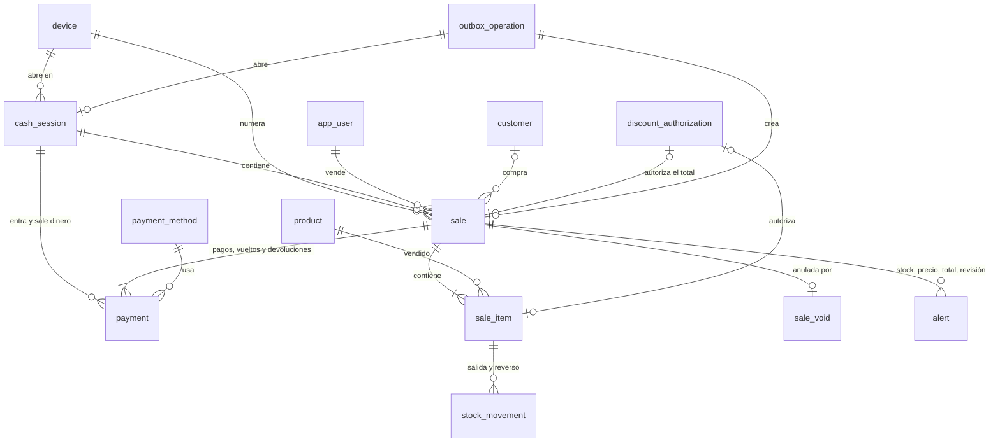

# Modelo de datos: ventas multimoneda, pagos mixtos, descuentos y apertura de caja

Las tablas de la migración `0006_ventas_y_caja` afinan `docs/modelo-de-datos.md` en
§3.1 (equipos y alertas), §3.6 (ventas), §3.7 (caja) y §3.8 (sincronización).
Convenciones del modelo (§1):

- `id` UUIDv7. En las tablas marcadas "id del equipo", el id lo genera el navegador
  (R4).
- Dominios decimales de ADR-0004: `usd_amount`, `usd_cost`, `ves_amount`, `rate`,
  `quantity`, `percent`.
- Enumeraciones como `text` con `CHECK`.
- Nada se borra (R9).

## Diagrama

## Tablas nuevas

### `device` (FR-001 a FR-004; RN-11; R3)

| Columna | Tipo | Reglas |
|---|---|---|
| `name` | text | 1–60 caracteres |
| `series` | text | `^[A-Z]{1,3}$`, única, nunca reutilizada (contador `device_series`) |
| `last_sequence_number` | int | ≥ 0. Mayor correlativo registrado; solo aumenta |
| `token_hash` | text | SHA-256 del token, único |
| `registered_by`, `registered_at` | | Admin |
| `revoked_at`, `revoked_by` | nulos | Se fijan juntos y una sola vez |

Sin `DELETE`. Las FK pendientes desde la 1.1 se agregan ahora:
`user_session.device_id`, `stock_movement.device_id` y `audit_log.device_id` →
`device.id`.

### `cash_session` (FR-005 a FR-009; RF-29, RF-30, RN-16; R7). Id del equipo

| Columna | Tipo | Reglas |
|---|---|---|
| `device_id` | uuid → `device` | |
| `business_date` | date | Fecha de negocio (Caracas) de la apertura |
| `opened_by`, `opened_at` | | Usuario de la operación; hora del equipo |
| `opening_float_ves` | `ves_amount` | ≥ 0 |
| `opening_float_usd` | `usd_amount` | ≥ 0 |
| `status` | text | `open` (la 1.4 agrega `closed`) |
| `outbox_operation_id` | uuid → `outbox_operation` | Única |

Índice único parcial `(device_id) WHERE status = 'open'`. El trigger impide `DELETE` y
cambiar cualquier columna salvo `status` (que en esta etapa no tiene a qué cambiar).

### `customer` (FR-019; RF-28; R11). Id del equipo

| Columna | Tipo | Reglas |
|---|---|---|
| `name` | text | 2–100 caracteres |
| `document_id` | text, nulo | Cédula `^[VE]-\d{6,8}$` o RIF `^[JGVEPC]-\d{8}-\d$`; índice único. `V` o `E` sin guiones es siempre cédula (R11) |
| `phone` | text, nulo | Hasta 30 caracteres |
| `created_at`, `created_by` | | |

Sin `DELETE`. Edición en la Fase 2.

### `payment_method` (FR-033, FR-034; RF-24)

Catálogo fijo, cargado por la migración. Columnas: `code` (PK), `name`, `currency`
(`VES`, `USD`, `USDT`), `requires_reference`, `is_cash` y `sort_order`.

| `code` | Nombre | Moneda | Referencia | Efectivo |
|---|---|---|:-:|:-:|
| `cash_ves` | Efectivo Bs | VES | | ✅ |
| `mobile_payment` | Pago móvil / transferencia | VES | ✅ | |
| `pos_card` | Punto de venta | VES | ✅ | |
| `cash_usd` | Efectivo USD | USD | | ✅ |
| `zelle` | Zelle | USD | ✅ | |
| `binance_usdt` | Binance USDT | USDT | ✅ | |

Se usa `code` como clave (en lugar de un UUID) porque los métodos son fijos y el
equipo los conoce sin consultarlos. `is_active` llega cuando el Admin pueda
administrarlos.

### `sale` (FR-013 a FR-018, FR-028; RF-26, RN-05, RN-11). Id del equipo; solo inserción

| Columna | Tipo | Reglas |
|---|---|---|
| `device_id` | uuid → `device` | |
| `series`, `sequence_number` | text, int | Único `(series, sequence_number)`; `sequence_number` ≥ 1 |
| `number` | text | `{series}-{sequence_number con 6 dígitos}`, único |
| `cash_session_id` | uuid → `cash_session` | Del mismo equipo (lo valida el servicio) |
| `seller_id` | uuid → `app_user` | Quien vendió; en la 1.3, igual al usuario de la sesión que la envía (R17) |
| `customer_id` | uuid → `customer`, nulo | |
| `occurred_at` | timestamptz | Hora del equipo |
| `business_date` | date | Fecha de negocio (Caracas) de `occurred_at` |
| `synced_at` | timestamptz | Llegada al servidor |
| `exchange_rate`, `exchange_rate_date` | `rate`, date | Copia de la tasa usada (RN-05, RF-18) |
| `subtotal_usd` | `usd_amount` | Σ (subtotal de línea − descuento propio) |
| `discount_type`, `discount_value` | text, numeric, nulos | `amount` (`usd_amount`) o `percent` (`percent`), juntos |
| `discount_usd` | `usd_amount` | 0 si no hay |
| `discount_authorized_by` | uuid → `app_user`, nulo | |
| `discount_authorization_method` | text, nulo | `pin`, `request`, `admin_self` |
| `discount_authorization_id` | uuid → `discount_authorization`, nulo | Único |
| `total_usd` | `usd_amount` | `subtotal_usd − discount_usd`, ≥ 0 |
| `total_ves` | `ves_amount` | `round(total_usd × exchange_rate)` (RN-02) |
| `paid_usd` | `usd_amount` | Σ pagos en USD |
| `change_usd` | `usd_amount` | Σ vueltos en USD (≤ `paid_usd − total_usd` si lo pagado cubre) |
| `device_total_usd` | `usd_amount` | Total calculado en el equipo |
| `needs_review` | bool | Descuento de Vendedor sin autorización válida (R8) |
| `outbox_operation_id` | uuid → `outbox_operation` | Único |

`CHECK`: el tipo, el valor y el monto del descuento van juntos; el método de
autorización solo puede existir si hay descuento.

### `sale_item` (FR-011 a FR-013, FR-020 a FR-027, FR-049). Id del equipo; solo inserción

| Columna | Tipo | Reglas |
|---|---|---|
| `sale_id`, `line_number` | | Único `(sale_id, line_number)`, desde 1 |
| `product_id` | uuid → `product` | Un producto por línea (RN-13); se puede repetir en otra línea |
| `quantity` | `quantity` | > 0, con los decimales de la unidad, ya convertida de cm (RF-21) |
| `entered_unit` | text | `m`, `cm` o `unit`: cómo la escribió el vendedor (solo informativo) |
| `unit_price_usd` | `usd_amount` | Precio con el que se vendió (el del equipo) |
| `server_price_usd` | `usd_amount`, nulo | Precio vigente en el servidor si era distinto (alerta) |
| `line_subtotal_usd` | `usd_amount` | `round(precio × cantidad)` |
| `item_discount_type`, `item_discount_value` | nulos | Como en `sale` |
| `item_discount_usd` | `usd_amount` | 0 si no hay |
| `item_discount_authorized_by`, `item_discount_authorization_method`, `item_discount_authorization_id` | nulos | Como en `sale`; la autorización es única |
| `allocated_sale_discount_usd` | `usd_amount` | Parte del descuento total (R1) |
| `line_total_usd` | `usd_amount` | Subtotal − descuento propio − parte asignada, ≥ 0 |
| `unit_cost_usd` | `usd_cost`, nulo | Costo promedio al registrarse (solo Admin, FR-049) |

### `payment` (FR-033 a FR-039; RF-23 a RF-25, RN-04 a RN-06; R1, R10). Solo inserción

| Columna | Tipo | Reglas |
|---|---|---|
| `sale_id` | uuid → `sale` | |
| `line_number` | smallint | Orden dentro de la venta |
| `cash_session_id` | uuid → `cash_session` | Caja donde entra o sale el dinero |
| `kind` | text | `sale_payment` (entra), `change` (sale), `void_refund` (sale), `void_change` (entra) |
| `payment_method_code` | text → `payment_method` | |
| `currency` | text | Moneda del método |
| `amount` | `NUMERIC(16,2)` | > 0, en la moneda del método |
| `exchange_rate` | `rate` | Copia de la tasa de la venta |
| `amount_usd` | `usd_amount` | `round(amount ÷ tasa)` en VES; igual a `amount` en USD y USDT |
| `reference` | text, nulo | 1–60 caracteres; obligatoria si el método la exige (trigger contra `payment_method`) |
| `sale_void_id` | uuid → `sale_void`, nulo | Solo en `void_refund` y `void_change` |

### `sale_void` (FR-041 a FR-043; RF-27; R10). Solo inserción

`sale_id` (único), `reason` (5–500 caracteres), `voided_by` (Admin) y `voided_at`.

### `discount_authorization` (FR-023 a FR-027; RN-07; R8)

| Columna | Tipo | Reglas |
|---|---|---|
| `sale_id` | uuid | Id del equipo de la venta en curso (todavía no existe en `sale`; sin FK) |
| `sale_item_id` | uuid, nulo | Línea; nulo = descuento sobre el total |
| `product_id` | uuid → `product`, nulo | Para mostrarle al Admin qué se descuenta |
| `discount_type` | text | `amount` o `percent` |
| `requested_value` | numeric | Valor pedido por el vendedor |
| `discount_value` | numeric | Valor autorizado: igual al pedido con PIN; con solicitud, el que aprueba el Admin (≤ pedido) |
| `base_usd` | `usd_amount` | Monto al que se aplica |
| `discount_usd` | `usd_amount` | Descuento resultante |
| `method` | text | `pin` o `request` |
| `status` | text | `pending`, `approved` o `rejected`; `pin` nace `approved` |
| `requested_by`, `requested_at`, `device_id` | | Vendedor y equipo |
| `decided_by`, `decided_at` | nulos | Admin; juntos con `approved` o `rejected` |
| `rejection_reason` | text, nulo | Opcional, hasta 200 caracteres |

El trigger permite solo `pending` → `approved` (en la que `discount_value` y
`discount_usd` pueden bajar; el cálculo lo hace el servicio con `sale_math`, el trigger
solo lo admite) o `rejected`, y rechaza `DELETE`. Que se
use una sola vez lo garantizan los índices únicos de `sale` y `sale_item`.

### `outbox_operation` (FR-017; ADR-0003; R4)

| Columna | Tipo | Reglas |
|---|---|---|
| `id` | uuid | Del equipo; clave de idempotencia |
| `device_id` | uuid → `device` | |
| `user_id` | uuid → `app_user` | Quien la envió (sesión) |
| `operation_type` | text | `cash_session.open`, `sale.create` (la 1.4 y la 1.5 suman tipos) |
| `schema_version` | smallint | 1 |
| `payload` | jsonb | Contenido recibido |
| `created_at_device` | timestamptz | Hora del equipo al crearla |
| `received_at`, `processed_at` | timestamptz | |
| `status` | text | `processed` o `rejected` |
| `http_status` | smallint | Respuesta guardada (200, 409, 422) |
| `result` | jsonb, nulo | Respuesta de la operación procesada |
| `error` | jsonb, nulo | `{code, message, fields}` del rechazo |

Sin `UPDATE` ni `DELETE`: la fila se inserta ya con su resultado, dentro de la
transacción que procesa la operación (R4).

## Cambios en tablas existentes

- `alert.type`: suma `negative_stock`, `price_mismatch`, `total_mismatch`,
  `rate_mismatch`, `discount_review` e `inactive_user_sync` (R6). `entity_type = 'sale'`.
- `stock_movement`: las ventas usan `type = 'sale'` (negativo) y las anulaciones
  `type = 'sale_void'` (positivo), con `reference_type = 'sale_item'` y `device_id`.
  Las salidas por venta usan `allow_negative = True` (RN-10).
- `sequence_counter`: fila `device_series`.
- `product`: sin cambios.

## Reglas transversales

- **Cálculo**: solo en `domain/sale_math.py` y `money.ts`, con los mismos casos (R1).
  Los totales que envía el equipo se guardan aparte (`device_total_usd`); los
  guardados son los del servidor.
- **Transacción única**: venta, líneas, pagos, movimientos, autorizaciones usadas,
  cliente nuevo, alertas, auditoría y la fila de `outbox_operation` se escriben juntos
  o nada (FR-018).
- **Inmutabilidad**: R9. Ninguna venta, línea, pago ni anulación cambia, ni con SQL
  directo (SC-010).
- **Previsión Fase 3**: `line_total_usd` por línea es la base para desglosar IVA
  (RN-17); los pagos en divisas por fila permiten calcular IGTF; el número interno no
  se usa como número fiscal (ADR-0003).

## Cambios a `docs/modelo-de-datos.md` (al cerrar la etapa)

- §3.1:
  - `device` con `revoked_by` y serie de hasta 3 letras;
  - FK de `device_id`;
  - tipos de `alert` de la etapa;
  - fila `device_series` en `sequence_counter`.
- §3.6:
  - `payment_method` con `code` como clave;
  - `sale` con `paid_usd`, `change_usd`, autorización del descuento total y su
    unicidad;
  - `sale_item` con `entered_unit`, `server_price_usd` y la autorización del ítem;
  - `payment` con `line_number`, `kind` `void_change` y referencia de 60
    caracteres;
  - `discount_authorization` como tabla única de autorizaciones por PIN y
    solicitudes (reemplaza `discount_request`);
  - `customer.document_id` normalizado.
- §3.7: `cash_session` solo con `open` hasta la 1.4; esperado por método con
  `void_change`.
- §3.8: `outbox_operation` con `http_status` y `created_at_device`, sin `failed`
  (pasa a llamarse `rejected`).
