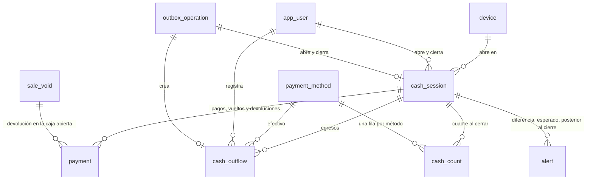

# Modelo de datos: caja, egresos, cierre y cuadre

La migración `0007_cierre_de_caja` amplía `cash_session` y crea `cash_outflow` y
`cash_count`. Afina `docs/modelo-de-datos.md` §3.7 (caja), §3.1 (alertas) y §3.8 (tipos de
operación de la cola). Convenciones del modelo (§1):

- `id` UUIDv7. En las tablas marcadas "id del equipo", el id lo genera el navegador.
- Dominios decimales de ADR-0004 (`usd_amount`, `ves_amount`, …).
- Enumeraciones como `text` con `CHECK`.
- Nada se borra.

## Diagrama



## `cash_session` (columnas nuevas; R2)

| Columna | Tipo | Notas |
|---|---|---|
| `status` | text | `open` \| `closed` (CHECK ampliado) |
| `closed_at` | timestamptz, nulo | Hora del cierre: `created_at` de la operación de la cola o la del servidor en el cierre del Admin desde otro lugar |
| `closed_by` | uuid → `app_user`, nulo | Quien cerró (RN-16: puede ser distinto de quien abrió) |
| `closed_from_device_id` | uuid → `device`, nulo | Equipo desde el que se cerró; nulo si el Admin cerró desde un navegador que no es equipo |
| `closed_outside_device` | boolean, nulo | true si no se cerró desde el equipo de la caja (US5) |
| `closing_note` | text, nulo | 5–500 caracteres; obligatoria con diferencias o fuera del equipo (lo exige el servicio) |
| `closing_operation_id` | uuid → `outbox_operation`, nulo, único | Operación `cash_session.close`; diferida como `outbox_operation_id`; nula en el cierre del Admin (R6) |

**Restricciones**:

- `ck_cash_session_status_valid`: `status IN ('open', 'closed')`.
- `ck_cash_session_closing`: si `status = 'closed'`, `closed_at`, `closed_by` y
  `closed_outside_device` no son nulos; si `status = 'open'`, todas las columnas de
  cierre son nulas.
- `ck_cash_session_note_length`: `closing_note` es nula o tiene entre 5 y 500
  caracteres.
- Sigue el índice único parcial `ux_cash_session_open_device (device_id) WHERE status =
  'open'` (RN-16). Al cerrar se libera y el equipo puede abrir otra caja.
- Índice nuevo `ix_cash_session_business_date (business_date DESC, opened_at DESC)` para
  la consulta del Admin.

**Trigger `cash_session_guard`** (reemplaza al de la 1.3):

- Los datos de apertura (`id`, `device_id`, `business_date`, `opened_by`, `opened_at`,
  los fondos y `outbox_operation_id`) nunca cambian.
- La única transición válida es `open → closed`, que fija a la vez todas las columnas de
  cierre.
- Una caja `closed` no admite ningún `UPDATE`.
- Sigue `cash_session_no_delete`.

**Trigger de restricción diferido `cash_session_counts_complete`** (`AFTER UPDATE`,
`DEFERRABLE INITIALLY DEFERRED`): al confirmar, una caja que pasó a `closed` debe tener
exactamente una fila de `cash_count` por cada método de `payment_method`.

## `cash_outflow` (nueva; id del equipo; RF-32; R3)

| Columna | Tipo | Notas |
|---|---|---|
| `id` | uuid | Generado en el equipo |
| `cash_session_id` | uuid → `cash_session` | Caja de la que sale el dinero |
| `device_id` | uuid → `device` | Equipo que lo registró |
| `payment_method_code` | text → `payment_method` | `CHECK IN ('cash_ves', 'cash_usd')` |
| `currency` | text | `VES` o `USD`, la del método (`CHECK` con el método) |
| `amount` | numeric(16, 2) | > 0, en la moneda del método |
| `reason` | text | 5–200 caracteres |
| `created_by` | uuid → `app_user` | Usuario de la sesión que lo envió |
| `occurred_at` | timestamptz | `created_at` de la operación en el equipo |
| `outbox_operation_id` | uuid → `outbox_operation`, único | Diferida, como en la venta |
| `voided_at`, `voided_by`, `void_reason` | nulos | Anulación del Admin; las tres juntas; motivo 5–200 |

**Restricciones e índices**: `ck_cash_outflow_method` (método y moneda coherentes:
`cash_ves`/`VES` o `cash_usd`/`USD`), `ck_cash_outflow_amount_positive`,
`ck_cash_outflow_reason_length`, `ck_cash_outflow_void` (las tres columnas de anulación
nulas o completas, motivo 5–200), `ix_cash_outflow_cash_session (cash_session_id)`.

**Trigger `cash_outflow_guard`** (`BEFORE UPDATE OR DELETE`):

- No se borra.
- Solo cambian `voided_at`, `voided_by` y `void_reason`, una vez (de nulas a
  completas).
- Solo si la caja del egreso está `open` (R3).

El servicio valida que la caja esté abierta al insertar (o el caso de R7) y que el monto
no supere el efectivo esperado. La base no lo impone porque depende del cálculo de R1.

## `cash_count` (nueva; RF-31; R2)

Una fila por método de pago de una caja cerrada. Solo inserción.

| Columna | Tipo | Notas |
|---|---|---|
| `id` | uuid | Generado en el servidor |
| `cash_session_id` | uuid → `cash_session` | |
| `payment_method_code` | text → `payment_method` | |
| `currency` | text | La del método |
| `expected_amount` | numeric(16, 2) | Esperado según el servidor (R1); puede ser negativo |
| `device_expected_amount` | numeric(16, 2), nulo | Esperado que vio el equipo; nulo en el cierre del Admin desde otro lugar (R6) |
| `counted_amount` | numeric(16, 2) | ≥ 0; contado (efectivo) o verificado (electrónicos) |
| `difference` | numeric(16, 2) | `counted_amount − expected_amount` (`CHECK`) |

**Restricciones**:

- `ux_cash_count_method UNIQUE (cash_session_id, payment_method_code)`.
- `ck_cash_count_counted_non_negative`.
- `ck_cash_count_difference`: `difference = counted_amount − expected_amount`.

**Triggers**:

- `cash_count_immutable`: `BEFORE UPDATE OR DELETE` con `reject_change()`.
- `cash_count_session_closed`: `BEFORE INSERT`, rechaza la fila si su caja no está
  `closed`. El servicio cierra la caja y luego inserta los conteos en la misma
  transacción; con el único por método y `cash_session_counts_complete`, después del
  cierre no caben filas nuevas.

## `payment` (sin cambios de esquema; R8)

- Los espejos de una anulación (`void_refund`, `void_change`) pueden tener un
  `cash_session_id` distinto del de la venta: el de la caja abierta del equipo desde el
  que el Admin anula, cuando la caja de la venta está cerrada.
- La caja que recibió la devolución se deduce de esas filas. No hace falta una columna
  nueva en `sale_void`.

## `alert` (CHECK ampliado; R11)

`ck_alert_type_valid` suma `cash_difference`, `expected_mismatch` y
`post_close_operation`, con `entity_type = 'cash_session'` y `entity_id` = la caja.

## `outbox_operation` (sin cambios de esquema)

Tipos nuevos de `operation_type`: `cash_outflow.create` y `cash_session.close`.

## Esperado por método (R1)

```text
expected(método) = fondo (solo cash_ves y cash_usd)
                 + Σ sale_payment − Σ change − Σ void_refund + Σ void_change
                 − Σ cash_outflow no anulados
```

- Se suman solo los movimientos con `cash_session_id` = la caja, en la moneda del
  método.
- Las ventas registradas después del cierre (R7) y sus pagos tienen la caja cerrada como
  `cash_session_id`, pero no alteran el `cash_count` guardado. El detalle las muestra
  aparte.

## Reglas transversales

- **Transacción única**: el cierre (caja, conteos, alertas, auditoría y la fila de la
  cola), el egreso (egreso, auditoría y la fila de la cola) y la anulación con
  devolución en otra caja se escriben juntos o nada.
- **Bloqueos**: cerrar y registrar un egreso bloquean el equipo y la caja, como la
  venta. Así un egreso no se cuela entre el cálculo del esperado y el cierre.
- **Inmutabilidad** (SC-005): ningún cierre, conteo ni egreso se modifica ni se borra con
  SQL directo. La única excepción es la anulación de un egreso con la caja abierta.

## Cambios a `docs/modelo-de-datos.md` (al cerrar la etapa)

- §3.7:
  - `cash_session` con `closed`, sus columnas de cierre y el trigger ampliado;
  - `cash_outflow` con `payment_method_code`, `currency`, `device_id`,
    `outbox_operation_id` y la anulación;
  - `cash_count` con `payment_method_code`, `currency` y `device_expected_amount`;
  - la devolución de una anulación en otra caja.
- §1.4: `cash_session` inmutable al cerrarse; `cash_outflow` y `cash_count`.
- §3.1: tipos de alerta de la caja.
- §3.8: tipos de operación `cash_outflow.create` y `cash_session.close`.
